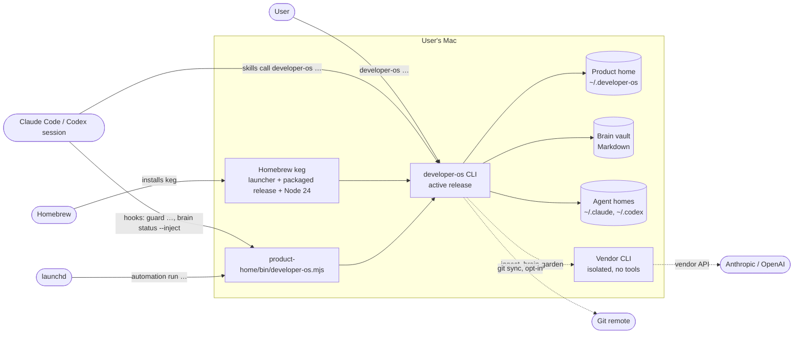
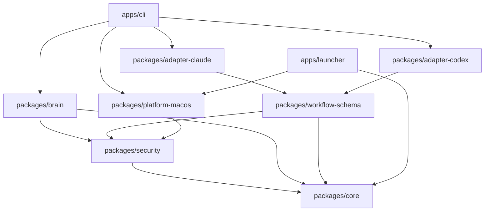

# Architecture overview

How Developer OS is built, as one picture. Each section summarises and links to the canonical note
that owns the contract; read that note before changing the subsystem.

## 1. System context



The product itself opens no network connection. The dashed edges are the only paths off the machine:
the vendor CLI the user already uses, and the Git remote the user configured.

## 2. Runtime components

| Component | Where | Role |
|---|---|---|
| Shell launcher | `<keg>/bin/developer-os`, linked by Homebrew | Runs the bundled Node with the stable launcher. |
| Stable launcher | `<keg>/libexec/launcher.mjs` (`apps/launcher`) | Resolves `HOME` and the product home, builds a closed environment, reads the bootstrap closure and the active release record, and execs the admitted release. Before `init` completes, or for `init`, it uses the keg's packaged release. A present but invalid active record is never silently replaced by the fallback. |
| Packaged release | `<keg>/libexec/fallback/` | A complete release with its own Node 24, admitted by owner, mode, inventory and hashes. |
| Active release | `<product-home>/releases/<version>/darwin-<arch>/` | The release the product runs after `init` or `update --apply`. |
| Entrypoint | `<product-home>/bin/developer-os.mjs` | Version-free entry for hooks and launchd jobs. Follows `state/active-release.json` and imports the release only when its hashes match the retained manifest. |
| CLI | `apps/cli` | Parses argv, builds the context, dispatches the command, renders output and exit code. |

Release trust comes from the Homebrew package channel (D84, D94): the keg's release index names each
bundle archive and manifest by size and SHA-256, and trust watermarks never move backwards.
Contract: [foundation.md](foundation.md) §11.

## 3. Packages



| Package | Owns | Note |
|---|---|---|
| `@developer-os/core` | Result and exit contracts, configuration, runtime paths, change plans, transactions, manifest and drift, the lifecycle kernel, Git planning, the update coordinator, instruction catalog and block grammar | [foundation.md](foundation.md) |
| `@developer-os/security` | Canonical paths and containment, the protected-path policy, redaction, the display screen, shell-free process execution, Git transport supervision | [threat-model.md](threat-model.md) |
| `@developer-os/platform-macos` | macOS facts, agent discovery, transaction and stable locks, retained renames, launchd plans and effects, launcher admission | [foundation.md](foundation.md) §1, §10 |
| `@developer-os/brain` | Note schema, discovery, indexes, lint, retrieval, capture/review/ingest logic, refactor, gardener. Pure: it never writes | [brain.md](brain.md), [knowledge-pipeline.md](knowledge-pipeline.md) |
| `@developer-os/workflow-schema` | The workflow contract, verb vocabulary, validation and rendering inputs | [workflow-schema.md](workflow-schema.md) |
| `@developer-os/adapter-claude` | Claude discovery, capabilities, plugin and instruction rendering, hooks, invocation | [claude-adapter.md](claude-adapter.md) |
| `@developer-os/adapter-codex` | The same for Codex, plus marketplace registration | [codex-adapter.md](codex-adapter.md) |
| `@developer-os/cli` | Commands, composition root, hooks entry, bootstrap, lifecycle, update orchestration | [foundation.md](foundation.md) §1 |
| `@developer-os/launcher` | The stable launcher | [foundation.md](foundation.md) §11 |
| `@developer-os/tests` | Process-level evidence against the compiled binary, repository gates, release tools | [Development guide](../development.md) |

The dependency direction is strictly downward: nothing below the CLI knows a command exists, and
neither adapter imports the other. `apps/cli/src/bin.ts` is the only place production dependencies
are constructed; every command receives a `CliContext`, which is what lets the suites run against a
temporary home.

Runtime third-party dependencies are three: `zod` (schemas), `smol-toml` (configuration) and `yaml`
(frontmatter and workflow contracts).

## 4. State model

| Store | Owned by | Written how |
|---|---|---|
| Product home | the product | Transactions and the lifecycle coordinator; the manifest is the one self-written exception |
| Installation manifest | the product | Every managed artifact with owner, kind, hash and verification mode (`file`, `directory`, `schema`, marked `block`) |
| Brain vault | the user | Only by transactions the user triggered: reindex, ingest, retire, refactor, capture into quarantine |
| Agent homes | the vendors and the user | Only manifest-owned files and one marked block per shared file |
| User overrides | the user | Never written by the product |

**Drift.** Every managed artifact is compared with its recorded hash. Drift in a managed file stops
the next mutating command with a three-way report (exit 3); the product never overwrites a drifted
user change.

## 5. The mutation pipeline

```text
plan → backup → stage → validate → apply → verify → finalize
                 └────────── on failure before finalize ──────────▶ rolled_back
```

- A change plan names every create, replace and remove with its precondition hash.
- The journal `state/transactions/<id>.json` is written after each phase, so it always describes
  work already done. An interrupted transaction is incomplete, never successful; `repair` resumes
  or rolls it back.
- Composite operations (uninstall, Git enable, automation enable, update, rollback) run under the
  **lifecycle coordinator**: one global lock, one allocated ID block, a journal per participant, and
  journaled external effects (Git, launchd). Recovery re-derives every step from durable evidence.
- Every mutating command passes the **mutation gate**: a clean lifecycle closure, an admitted
  manifest, no residue of another operation.

Contracts: [foundation.md](foundation.md) §3–§5, §10; [foundation-constraints.md](foundation-constraints.md).

## 6. Main flows

### 6.1 `init`

1. Admit the platform, the product home, the vault path and the release source.
2. Run the bootstrap executor: plan the fresh home, publish the V2 handoff, retain its plan and
   journals as evidence.
3. Create the vault from the template only if it is absent.
4. Attach the selected vendors (one Foundation transaction), register the Codex plugin, detach the
   deselected ones.
5. Run the init-owned doctor checks; revert on failure.

### 6.2 Knowledge pipeline

```text
capture/import ─▶ redact ─▶ quarantine file ─▶ review ─▶ accepted
accepted ─▶ staging ─▶ prompt (capture as DATA + bounded index excerpt)
        ─▶ vendor CLI (isolated, tool-free) ─▶ structured proposal
        ─▶ nine validators ─▶ create notes (transaction) ─▶ ingested
run end ─▶ one reindex
```

Contract: [knowledge-pipeline.md](knowledge-pipeline.md); trust boundaries:
[threat-model.md](threat-model.md) §5.1–§5.7.

### 6.3 Hooks

The vendor runs the hook command with a JSON payload on stdin. The CLI recognises hook argv before
strict dispatch, decodes an allow-list of payload fields (never the transcript), runs one verb and
maps its outcome to the vendor's exit-code protocol. Firing records feed `doctor`.
Contract: [hooks.md](hooks.md) §3.

### 6.4 Update

`update` reads the installed keg, runs the target planner over the keg's bundle and prints a preview.
`--apply` revalidates under the global lock and runs the coordinator in a fixed forward order: bundle,
owner files, rollback payload, transitional manifest, trust, rollback record, active record, target
verifier, executor switch, retirement of the prior rollback set, terminal manifest. The target
verifier's durable success is the point of no return. `update rollback` runs the inverse from
retained evidence only. Contract: [foundation.md](foundation.md) §11.

### 6.5 Scheduled job

launchd starts `automation run <job> --scheduled --product-home <home> --generation <hash>`. The
runner authenticates the job's generation from manifest, plist and installation evidence, takes the
lifetime lease and the global lock, rechecks activation and eligibility, runs the handler, and records
a bounded status and log. A non-clear lifecycle state runs nothing. Contract:
`superpowers/specs/2026-08-21-developer-os-opt-in-surfaces-design.md` §5.

### 6.6 Git sync

Enumerate the exact scope (canonical notes plus four index files), refuse symlinks, hard links,
nested repositories, oversized files and secrets, stage exact paths into a commit, then push to the
recorded remote through supervised, allowlisted Git processes. A failed push is `push_pending` and
the next `git sync` retries it. Contract: the same spec, §4; [threat-model.md](threat-model.md) §5.15.

## 7. Security architecture

| Mechanism | Where |
|---|---|
| Redaction before persistence, logging, hashing, publication and model input; nine classes including user patterns | `packages/security/src/redaction.ts` |
| A per-install redaction key, so fingerprints are not reversible | `state/redaction.key` |
| Protected paths refused before reading | `packages/security/src/protected-paths.ts`; hook rules in `apps/cli/src/hooks/guards/path.ts` |
| Shell-free process execution with argument arrays and validated executables | `packages/security/src/process.ts` |
| No product network access, held by the lint gate and the e2e capability scan | `tests/repository/check.ts`, `tests/e2e/foundation.test.ts` |
| Guarded filesystem access: no-follow reads, 64-bit identities, owner and mode checks | `packages/core/src/lifecycle/guarded-fs.ts` |
| Tool-free, isolated vendor calls whose output is only a proposal | `apps/cli/src/commands/ingest.ts`, `packages/brain/src/ingest/validate.ts` |
| Hook guards on dangerous commands and protected paths | `apps/cli/src/hooks/` |

The boundary-by-boundary record, with what each mechanism cannot promise, is
[threat-model.md](threat-model.md).

## 8. Technology

| Area | Choice |
|---|---|
| Language | TypeScript 5.9, `strict` |
| Runtime | Node `>=24.16.0 <25`; the release bundles Node 24.16.0 per architecture |
| Workspace | pnpm 11 workspaces (`pnpm-workspace.yaml`) |
| Build | `tsc -b`; `esbuild` bundles the launchable CLI and launcher |
| Tests | Vitest 4 |
| Lint | ESLint 9 with `typescript-eslint`, plus the repository gate `tests/repository/check.ts` |
| Platform | macOS (Apple Silicon, Intel), `launchd`, Homebrew |
| Release tooling | GitHub Actions, gitleaks history scan, CycloneDX SBOM (`@cyclonedx/cdxgen`) |
