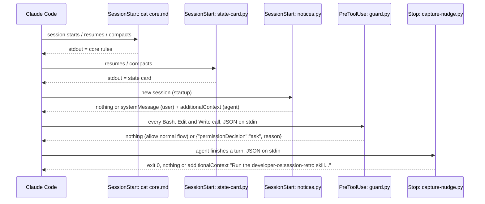
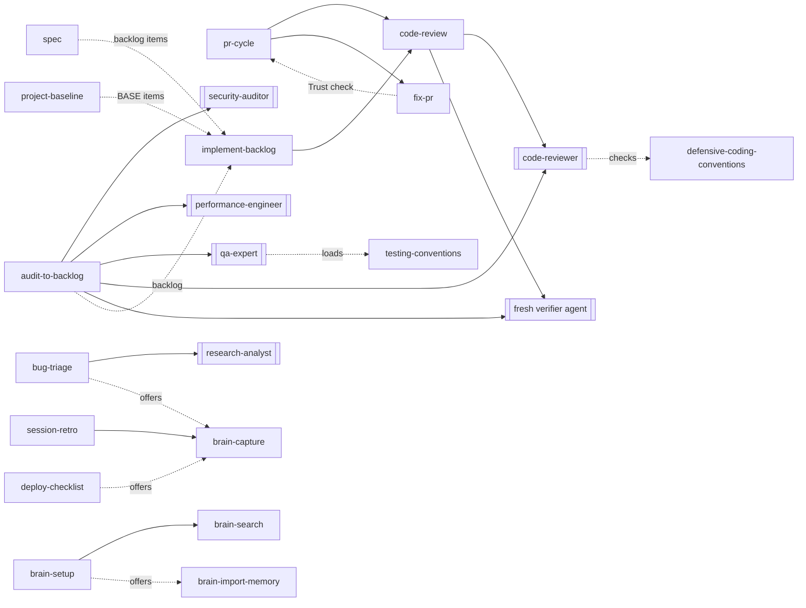

# Architecture overview

developer-os has no process of its own. Its architecture is what Claude Code loads, when, and what
the agent then reads and writes on the user's behalf.

## 1. Repository layout

```
.claude-plugin/marketplace.json   marketplace: one plugin, source ./plugin
plugin/                           the installed payload
  .claude-plugin/plugin.json      name, version, description, license, keywords
  rules/core.md                   core rules, printed by a SessionStart cat hook
  SURFACE.txt                     public names, checked against the disk
  hooks/hooks.json                5 hooks, 10-second timeouts
  hooks/state-card.py             SessionStart: state card after compaction, resume or fork
  hooks/notices.py                SessionStart: version and vault-upkeep notices on startup
  hooks/guard.py                  PreToolUse guard for Bash, Edit and Write
  hooks/capture-nudge.py          Stop hook: session wrap-up nudge
  skills/<name>/SKILL.md          32 skills
  agents/<name>.md                10 agents
  output-styles/<name>.md         4 output styles
  vault-template/                 copied by brain-setup
templates/project/                project template (not installed)
evals/                            claude plugin eval cases (not installed)
tests/*.test.sh                   script tests: hooks, check.sh, skill-usage block
.agnix.toml                       agnix lint settings for CI
scripts/check.sh                  the repository suite, also run by CI
docs/                             this documentation; docs/plans/ is git-ignored
site/                             public documentation site, published by .github/workflows/pages.yml
```

Only `plugin/` reaches a user's machine through the marketplace. `templates/` and `evals/` stay in
the repository; skills that mention them say so.

## 2. Load model

What occupies the context of a session, and when:

| Part | When it loads | Size today | Limit |
|---|---|---|---|
| `rules/core.md` | Every `SessionStart`: startup, resume, `/clear`, compaction, fork | Just under the limit | 8192 bytes (`scripts/check.sh`); Claude Code caps hook output at 10,000 characters |
| State card | After a compaction, resume or fork inside a git repository | Up to 1024 bytes | The `CAP` in `state-card.py`; the check keeps rules plus card under 10,000 |
| Skill names and descriptions | Every session, by Claude Code's skill listing | 11876 characters for 32 skills | 80–1024 each, 12000 total |
| Agent and output-style descriptions | Every session, by Claude Code's listings | Small | None in `check.sh` |
| A skill's body | When the model or the user invokes it | 0.8–11.5 KB per `SKILL.md` file | One screen where possible (CONTRIBUTING) |
| An agent's body | When a skill or the main agent dispatches it, in the subagent's own context | 1.9–4.0 KB per file | — |
| An output style | When selected; replaces the default style but keeps coding instructions | 0.6–2.0 KB | — |

The fixed cost per session is the core rules plus the listings. Everything else is paid only on
use, which is why conventions live in skills and not in the core rules.

## 3. Hook pipeline



- A `cat` hook prints `core.md` on every source, without Python. `state-card.py`, for `source`
  `compact`, `resume` or `fork` inside a git repository, prints the branch, the newest plan, `docs/plans/.devos-state.md` (skipped when older than
  7 days) and the worktrees, cut to whole lines within 1024 bytes.
- `notices.py`, for `source` `startup`, compares the plugin version with a marker in
  `${CLAUDE_PLUGIN_DATA:-${TMPDIR:-/tmp}/developer-os-<uid>}/notices/` (Claude Code has no install or
  update hook) and, when the user-level `CLAUDE.md` names a vault, counts `_inbox/` notes older than 7
  days and reads the last line of `_reports/garden-log.md`. It shows due notices to the user as a
  `systemMessage`, each throttled by its own marker.
- `guard.py` extracts `tool_input.command` with a regular expression, unescapes JSON, joins line continuations,
  drops quotes, splits on semicolons, newlines, ampersands, pipes, parentheses and backticks, and scans the words of each segment. Quotes are stripped on
  purpose, so a mention inside a commit message also asks. Any parse failure prints nothing.
- `capture-nudge.py` reads `session_id` and `transcript_path` from the input, counts
  `"type":"tool_use"` occurrences in the transcript file, defers while a background task
  launched in the session has no `<task-notification>` and a fresh output file under a `tasks/`
  directory, or while a Monitor started in the last 30 minutes has no terminal notice, and records a per-session
  marker in `${CLAUDE_PLUGIN_DATA:-${TMPDIR:-/tmp}/developer-os-<uid>}/capture-nudge/` so it fires once. Markers older than
  7 days are removed.

The four scripts are Python 3, standard library only; without `python3` they fail open. Exact inputs, outputs and switches: [reference/hooks.md](../reference/hooks.md).

## 4. Skill composition

Skills call each other by name and dispatch agents. The dependencies that exist today:



Every dispatched agent answers with a final status (`DONE`, `REVIEW`, `BLOCKED`, `CONTINUING`) that
the orchestrating skill reads before integrating. Solid arrows are invocations; dotted arrows are hand-offs through a file (the backlog), an offer
the user accepts, or a step one skill borrows from another (fix-pr applies pr-cycle's Trust check). Two skills sit outside the diagram: parallel-lanes reviews its integrated branch through
code-review, and brain-project-refresh leaves a missing hub as an inbox draft for brain-review. audit-to-backlog also
dispatches database-reviewer (data) and infra-reviewer (infra); code-review adds them for migration,
schema, query, IaC or CI diffs; docs-sync may hand approved items to docs-writer; project-baseline asks
dependency-upgrader for the three dependencies furthest behind. The backlog contract shared by audit-to-backlog, project-baseline and
implement-backlog is the `Backlog: <todo path>, <done path>` line, defaulting to `TODO.md` and
`TODO-done.md` ([reference/configuration.md](../reference/configuration.md)).

## 5. Data flows

| Flow | Reads | Writes | Leaves the machine? |
|---|---|---|---|
| Session start | `rules/core.md`; after compaction, resume or fork, `git` state and `docs/plans/.devos-state.md` of the repository root | — | As context to the model provider |
| Task state | — | `docs/plans/.devos-state.md` (implement-backlog, pr-cycle, audit-to-backlog) | No |
| Brain search | Vault Markdown (`rg`), skipping `_archive/`, `templates/`, `_views/` | — | Notes read go to the model provider |
| Capture / compile | Session context; vault for duplicates | One file in `_inbox/` | Only as context |
| Review / garden | Vault | Named moves and edits; `_reports/garden-log.md` | Only as context |
| Notices hook | `plugin.json`, the user-level `CLAUDE.md`, `_inbox/*.md` (first 2 KB), `_reports/garden-log.md` (last 4 KB) | Markers in the plugin data directory | Counts and dates only, to the user and as context |
| Setup | `vault-template/`, `~/.claude/CLAUDE.md`, `~/.claude/settings.json` | Vault files; the two config edits | No |
| Skill usage | `~/.claude/projects/**/*.jsonl` (counts only, `--no-filename`) | — | Counts only, as context |
| Session retro | `git`, `gh pr list` (read-only) | Approved items only | `gh` queries GitHub |
| PR skills | `git`, `gh` | Commits, pushes, PR body, thread replies after approval | Yes, to GitHub, after approval |
| Verifier | The claim and the repository path | — | No |
| Routines (optional, user-built) | The vault repository in Anthropic's cloud | `_inbox/` notes, an issue comment | Yes; see [workflow.md](../workflow.md#away-from-the-desk-optional) |

The plugin makes no network call itself. What the agent reads becomes model context; an agent with
web tools could send it further, which the plugin cannot prevent ([SECURITY.md](../../SECURITY.md)).

## 6. Trust boundaries

| Boundary | Untrusted input | Control |
|---|---|---|
| Vault notes | Text a past session or a phone capture wrote | Skills treat notes as data and never run commands or open URLs from them; phone captures arrive in `_inbox/` |
| PR review comments, issues, CI logs, code comments | Anyone who can comment, file an issue or push code | fix-pr, pr-cycle, bug-triage and code-review treat them as data and flag text that tries to instruct the agent; fix-pr flags non-collaborators; four `injection-*` evals check it |
| Code, diffs, fixtures, fetched pages | The reviewed repository or the web | Every agent prompt states they are data; research-analyst never fetches a URL built from local file contents |
| External repositories | `.claude/settings.json`, hooks, `.mcp.json` of a client or OSS repo | Core rule: read them before the first session, use a sandbox or plan mode, never copy them into user config unread |
| Subagent output | A delegate's edits | Core rule: auth/2FA/security changes from a subagent are unauthorized until reviewed; compare `git status` and `git diff` |
| Plugin updates | A new commit's hooks and rules | `SECURITY.md`: review the diff from the installed commit before updating; auto-update is off by default |
| Project instructions | A cloned repository's `CLAUDE.md` naming a vault | The notices hook reads the `Brain vault:` line from the user-level `CLAUDE.md` only and prints counts, never note names |
| Session transcripts | Past conversations | Only skill-usage reads them, and only counts; session-retro and docs-sync never open them |

## 7. Validation

`scripts/check.sh` is the single local gate, run before every commit and by
`.github/workflows/check.yml` (after an agnix lint step) on pushes to `development` and `main` and on pull requests. Its stages
and prerequisites are in [development.md](../development.md#the-check). Behavior is checked
separately by the evals, by hand ([evals/README.md](../../evals/README.md)).
