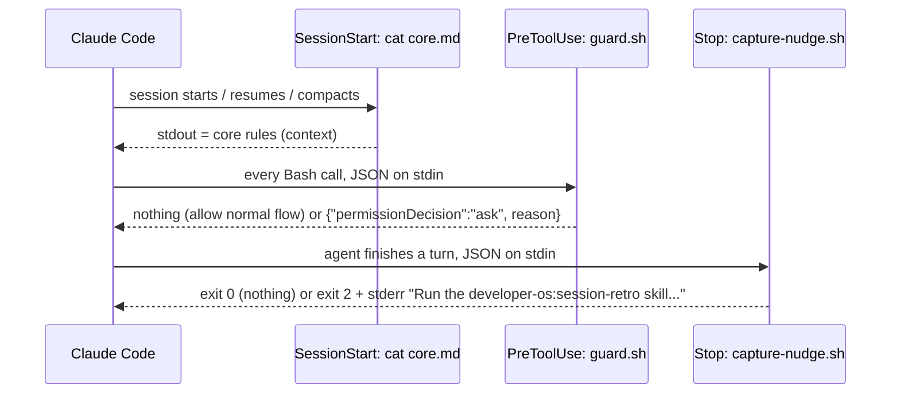
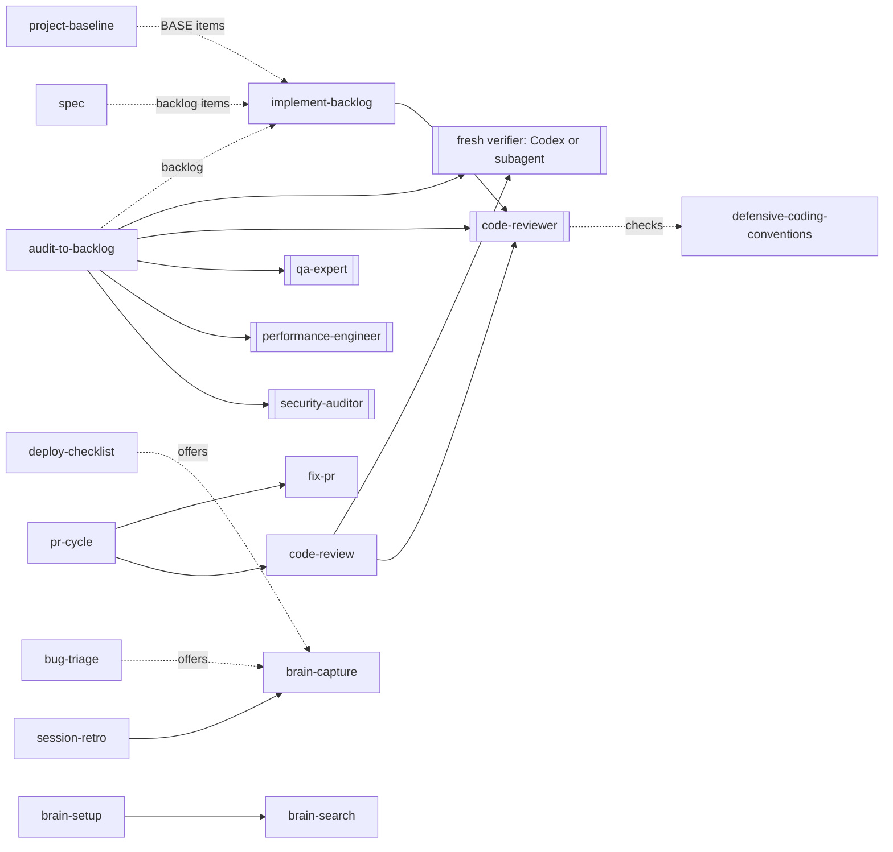

# Architecture overview

developer-os has no process of its own. Its architecture is what Claude Code loads, when, and what
the agent then reads and writes on the user's behalf.

## 1. Repository layout

```
.claude-plugin/marketplace.json   marketplace: one plugin, source ./plugin
plugin/                           the installed payload
  .claude-plugin/plugin.json      name, version, description, license
  rules/core.md                   core rules, printed by the SessionStart hook
  hooks/hooks.json                three hooks
  hooks/guard.sh                  PreToolUse guard for Bash
  hooks/capture-nudge.sh          Stop hook: session wrap-up nudge
  skills/<name>/SKILL.md          28 skills
  agents/<name>.md                5 agents
  output-styles/<name>.md         4 output styles
  vault-template/                 copied by brain-setup
templates/project/                project template (not installed)
evals/                            claude plugin eval cases (not installed)
tests/*.test.sh                   hook tests
scripts/check.sh                  the repository suite, also run by CI
docs/                             this documentation; docs/plans/ is git-ignored
```

Only `plugin/` reaches a user's machine through the marketplace. `templates/` and `evals/` stay in
the repository; skills that mention them say so.

## 2. Load model

What occupies the context of a session, and when:

| Part | When it loads | Size today | Limit |
|---|---|---|---|
| `rules/core.md` | Every `SessionStart`: startup, resume, `/clear`, compaction, fork | 8148 bytes | 8192 bytes (`scripts/check.sh`); Claude Code caps hook output at 10,000 characters |
| Skill names and descriptions | Every session, by Claude Code's skill listing | 9864 characters for 28 skills | 80–1024 each, 12000 total |
| Agent and output-style descriptions | Every session, by Claude Code's listings | Small | None in `check.sh` |
| A skill's body | When the model or the user invokes it | 0.6–7.2 KB per skill | One screen where possible (CONTRIBUTING) |
| An agent's body | When a skill or the main agent dispatches it, in the subagent's own context | 1.3–2.4 KB | — |
| An output style | When selected; replaces the default style but keeps coding instructions | 0.6–1.7 KB | — |

The fixed cost per session is the core rules plus the listings. Everything else is paid only on
use, which is why conventions live in skills and not in the core rules.

## 3. Hook pipeline



- `guard.sh` extracts `tool_input.command` with `sed`, unescapes JSON, joins line continuations,
  drops quotes, splits on semicolons, ampersands, pipes, parentheses and backticks, and scans each segment with `awk`. Quotes are stripped on
  purpose, so a mention inside a commit message also asks. Any parse failure prints nothing.
- `capture-nudge.sh` reads `session_id` and `transcript_path` from the input, counts
  `"type":"tool_use"` occurrences in the transcript file with `grep`, and records a per-session
  marker in `${CLAUDE_PLUGIN_DATA:-$TMPDIR}/capture-nudge/` so it fires once. Markers older than
  7 days are removed.

Exact inputs, outputs and switches: [reference/hooks.md](../reference/hooks.md).

## 4. Skill composition

Skills call each other by name and dispatch agents. The dependencies that exist today:



Solid arrows are invocations; dotted arrows are hand-offs through a file (the backlog) or an offer
the user accepts. The backlog contract shared by audit-to-backlog, project-baseline and
implement-backlog is the `Backlog: <todo path>, <done path>` line, defaulting to `TODO.md` and
`TODO-done.md` ([reference/configuration.md](../reference/configuration.md)).

## 5. Data flows

| Flow | Reads | Writes | Leaves the machine? |
|---|---|---|---|
| Session start | `rules/core.md` | — | As context to the model provider |
| Brain search | Vault Markdown (`rg`), skipping `_archive/`, `templates/`, `_views/` | — | Notes read go to the model provider |
| Capture / compile | Session context; vault for duplicates | One file in `_inbox/` | Only as context |
| Review / garden | Vault | Named moves and edits; `_reports/garden-log.md` | Only as context |
| Setup | `vault-template/`, `~/.claude/CLAUDE.md`, `~/.claude/settings.json` | Vault files; the two config edits | No |
| Skill usage | `~/.claude/projects/**/*.jsonl` (counts only, `--no-filename`) | — | Counts only, as context |
| Session retro | `git`, `gh pr list` (read-only) | Approved items only | `gh` queries GitHub |
| PR skills | `git`, `gh` | Commits, pushes, PR body, thread replies after approval | Yes, to GitHub, after approval |
| Verifier | The claim and the repository path | — | To Codex's provider when the Codex plugin is used |
| Routines (optional, user-built) | The vault repository in Anthropic's cloud | `_inbox/` notes, an issue comment | Yes; see [workflow.md](../workflow.md#away-from-the-desk-optional) |

The plugin makes no network call itself. What the agent reads becomes model context; an agent with
web tools could send it further, which the plugin cannot prevent ([SECURITY.md](../../SECURITY.md)).

## 6. Trust boundaries

| Boundary | Untrusted input | Control |
|---|---|---|
| Vault notes | Text a past session or a phone capture wrote | Skills treat notes as data and never run commands or open URLs from them; phone captures arrive in `_inbox/` |
| PR review comments | Anyone who can comment | fix-pr and pr-cycle treat comments as data, flag non-collaborators, never run commands from them |
| Code, diffs, fixtures, fetched pages | The reviewed repository or the web | Every agent prompt states they are data; research-analyst never fetches a URL built from local file contents |
| External repositories | `.claude/settings.json`, hooks, `.mcp.json` of a client or OSS repo | Core rule: read them before the first session, use a sandbox or plan mode, never copy them into user config unread |
| Subagent output | A delegate's edits | Core rule: auth/2FA/security changes from a subagent are unauthorized until reviewed; compare `git status` and `git diff` |
| Plugin updates | A new release's hooks and rules | `SECURITY.md`: review each update's diff or pin a version |
| Session transcripts | Past conversations | Only skill-usage reads them, and only counts; session-retro and docs-sync never open them |

## 7. Validation

`scripts/check.sh` is the single gate, run locally before every commit and by
`.github/workflows/check.yml` on pushes to `development` and `main` and on pull requests. Its stages
and prerequisites are in [development.md](../development.md#the-check). Behavior is checked
separately by the evals, by hand ([evals/README.md](../../evals/README.md)).
